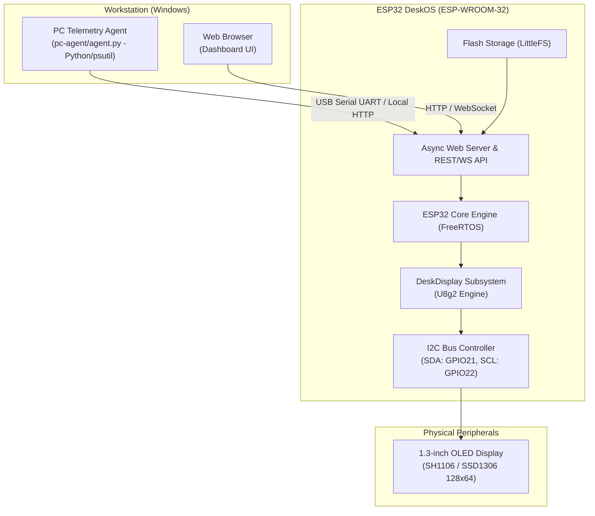

# ESP32 DeskOS — System Architecture

ESP32 DeskOS is designed as a modular desktop companion system comprising three distinct layers:
1. **Embedded Firmware (C++ / Arduino / PlatformIO)** running on the ESP32.
2. **Web Dashboard (HTML / CSS / JS)** served directly by the ESP32 (via LittleFS / SPIFFS) or accessible locally.
3. **PC Telemetry Agent (Python / psutil)** running locally on the workstation.

---

## 1. System Block Diagram

---

## 2. Firmware Subsystems

### A. Display Subsystem (`src/display.cpp`, `src/display.h`)
- Built on top of the battle-tested `olikraus/U8g2` monochrome graphics library.
- Operates in full-buffer mode (`_F_`) for flicker-free page flipping and rendering.
- Encapsulates display modes:
  - Startup / System status screen
  - PC telemetry gauges (CPU %, RAM %, CPU temp)
  - Animated robot eye states (neutral, happy, angry, blinking, looking around)
  - Full-screen QR code generator
  - Digital clock / uptime display
  - Custom user notifications

### B. Pin & Hardware Mapping (`include/pins.h`, `include/config.h`)
- Centralized hardware definitions ensure portability between standard ESP32, ESP32-S3, and ESP32-C3 boards.
- Display controller switchable via preprocessor flag (`OLED_CONTROLLER_SH1106`).

### C. Main Engine & Non-blocking Scheduler (`src/main.cpp`)
- Built without blocking `delay()` in the main execution loop.
- Uses `millis()` periodic intervals to manage heartbeats, screen redraws, sensor reads, and telemetry polling.

---

## 3. Web Dashboard Layer (`data/`)

- **Tech Stack:** Vanilla HTML5, modern CSS3 (custom variables, responsive grid, dark mode), and lightweight ES6 JavaScript.
- **No Heavy Frameworks:** Keeps memory footprint negligible for serving from ESP32 flash memory.
- **Key Modules:**
  - Active display mode selector
  - Brightness control (I2C contrast command)
  - Robot eye expression previewer
  - Real-time PC telemetry gauges
  - QR payload input
  - Wi-Fi and I2C hardware diagnostics

---

## 4. Workstation Telemetry Agent (`pc-agent/`)

- Runs under `uv` without requiring global system Python installations.
- Queries operating system statistics through `psutil` (unprivileged).
- Outputs structured JSON conforming to `esp32-deskos-telemetry-v1`.
- Communicates with DeskOS via USB Serial UART or local Wi-Fi HTTP POST/WebSocket.
